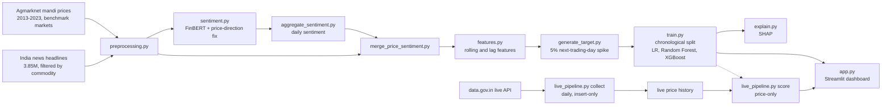

# Agricultural Commodity Price Spike Predictor

Predicts whether the wholesale price of an Indian agricultural commodity will rise **5% or more on the
next trading day**, combining historical mandi prices (Agmarknet) with FinBERT sentiment of news
headlines. Covers **Onion, Soyabean, Wheat and Potato**. Includes a Streamlit dashboard and a daily
live-price collector. Semester project (AI / ML / NLP).

**Result, stated plainly:** only **Soyabean** produced a usable model. Onion was weak. Wheat and Potato
produced negative results, which are reported rather than hidden. Most of the engineering effort went
into making the data and the evaluation trustworthy (see *Findings*).

## Results

Chronological train/test split (never shuffled); metrics on the held-out, later period.

| Commodity | Benchmark market | Spike rate | Test spikes | Random Forest F1 / ROC-AUC | Outcome |
|---|---|---|---|---|---|
| Soyabean | Indore | 7.3% | 63 | 0.657 / 0.873 | Usable model |
| Onion | Lasalgaon | 22.5% | 99 | 0.309 / 0.585 | Weak |
| Potato | Khatra | 3.3% | 26 | 0.000 / 0.524 | No viable model: models did not beat chance (best ROC-AUC 0.616) |
| Wheat | Kanpur (Grain) | 0.39% | 3 (70/30 split) | 0.000 / 0.649 | No model: only 11 spike events in 10 years |

* For Onion, Logistic Regression scored marginally higher than Random Forest (F1 0.349, ROC-AUC 0.589).
  Random Forest is used throughout the dashboard and SHAP analysis for consistency; both are weak.
* Wheat's test set has 3 positives, so its metrics are not meaningful and are reported only as such.
* Potato's viability rule was fixed **before** training (test ROC-AUC >= 0.65 and Random Forest
  precision >= 3x the base rate). It failed both. The 5% threshold was not changed to improve results.

## How it works



## Quick start (dashboard only)

The processed data and trained models are committed, so the dashboard runs without downloading anything.

```bash
git clone https://github.com/SiddheshGirde/Agricultural-Commodity-Price-Spikes-Predictor.git
cd Agricultural-Commodity-Price-Spikes-Predictor
python -m venv .venv
.venv\Scripts\activate          # Windows;  source .venv/bin/activate on macOS/Linux
pip install -r requirements.txt
streamlit run app.py
```

Developed and tested on Windows with Python 3.14. The **Live monitor** tab is empty until the collector
has run (see below); the **Historical backtest** tab works immediately.

## Reproducing the pipeline from raw data

Raw data is not in the repository (size, and the news text is third-party). Download it, then run the stages in order.

| Data | Source | Put it in |
|---|---|---|
| Daily mandi prices 2001-2026 (Parquet) | [Kaggle: khandelwalmanas/daily-commodity-prices-india](https://www.kaggle.com/datasets/khandelwalmanas/daily-commodity-prices-india) | `Data/parquet/` (files `2001.parquet`, ...) |
| India news headlines | [Kaggle: therohk/india-headlines-news-dataset](https://www.kaggle.com/datasets/therohk/india-headlines-news-dataset) | `data/raw/news/india-news-headlines.csv` |

```bash
python src/preprocessing.py            # clean + filter prices and headlines   (add --inspect for samples)
python src/sentiment.py                # FinBERT scoring (downloads the model on first run; CPU takes minutes)
python src/aggregate_sentiment.py      # headline-level -> daily sentiment
python src/merge_price_sentiment.py    # align with the price calendar
python src/features.py                 # rolling / lag price features
python src/generate_target.py          # 5% next-trading-day spike label
python src/train.py                    # chronological split, LR / Random Forest / XGBoost
python src/explain.py                  # SHAP for the commodities with a viable model
```

Paths are resolved from the repository location (`src/config.py`), so the project runs from any folder.

## Live price collector

`src/live_pipeline.py` collects one benchmark-market price per commodity per day from data.gov.in
(Agmarknet). It is separate from the historical pipeline, and the dashboard never calls the API.

```bash
copy .env.example .env                    # then put your own data.gov.in API key in .env
python src/live_pipeline.py collect       # at most one settled fetch per day
python src/live_pipeline.py score         # local files only; price-only prediction
python src/live_pipeline.py status
python src/live_pipeline.py probe         # read-only: how full is today's feed right now?
powershell -ExecutionPolicy Bypass -File scripts\setup_task.ps1    # Windows: run daily at 8 PM, catch up if missed
```

Design rules (each came from a problem found on real data):
* **One settled fetch per day.** From 18:00 (`SETTLE_HOUR`, a guess) a finished outcome closes the day; earlier
  runs never close it and never save a partly filled current day. The day's feed fills in gradually
  (onion: 601 rows at 14:50, 759 at 19:34 on one observed day).
* **Datewise, insert-only.** Rows are keyed by the data's own date; an existing date is never overwritten.
* **Scoring needs 7 recent consecutive trading days** (no gap over 7 days, newest at most 7 days old) and says
  why it refuses otherwise. An earlier version computed features across a ~3-year gap; it was replaced.
* **Market names are matched ignoring spacing, case and "APMC" prefix/suffix.** The live feed formats names
  differently from the archive (`Kanpur(Grain) APMC`, `APMC Lasalgaon `). Sub-yards such as `Lasalgaon(Vinchur)` are
  different markets and are never substituted.
* **The API needs a browser-like `User-Agent`** (otherwise an empty HTTP 502), and the shared sample key caps
  responses at 10 records; use your own key.

Live predictions are **price-only** (no live news) and out-of-time (models trained on 2013-2023 prices), so
treat them as indicative, not calibrated.

## Adding a commodity

Commodities live in one file, `src/config.py` (archive name, benchmark market, news pattern, live market name,
and whether a viable model exists). Screening comes first:

```bash
python src/screen_commodities.py --names tomato potato --top-markets 8     # compare markets
python src/screen_commodities.py --names tomato --live-only                # only markets present in today's live feed
python src/check_live_markets.py Potato:Khatra "Potato:Bishnupur (Bankura)"
```

The screen applies the pipeline's own definitions to the whole archive. Its verdicts matched the three original
outcomes (Onion NOISY -> weak model; Soyabean CANDIDATE -> usable model; Wheat TOO-FEW-SPIKES -> no model),
though three cases are too few to prove the rule. Passing the screen is necessary, not sufficient: Potato was
the strongest candidate and still produced a negative result.

## Method and leakage controls

* **Target:** spike = the next *reported* trading day's price is >= 5% above today's (mandis do not report every
  calendar day, so "next day" means the next day the market reported).
* **One price per day:** the mean modal price across varieties at one benchmark market (not a national average).
* **Features (19):** price, min/max, rolling mean/std (3 and 7 reported days), momentum, lag, 1- and 3-day change,
  intraday range, and daily sentiment aggregates with a `has_news` flag. Every feature for day *t* uses only data
  up to *t*; `shift(-1)` is used once, to build the label.
* **Evaluation:** chronological split (80/20; 70/30 only where 80/20 left too few test spikes), scalers fit on
  training data only, class weighting, and accuracy / precision / recall / F1 / ROC-AUC / confusion matrix.
  Metrics with too few positives are flagged as unstable instead of being reported as results.
* **Window:** 2013-07-01 to 2023-06-30, the overlap of the price data and the news dataset (which ends 2023-06-30).

## Findings

* **FinBERT domain gap.** FinBERT was trained on investor language, where rising prices are good news. It scored
  **58.6% of "price up" headlines as positive** (e.g. "Onion prices shoot up by 52%": 0.92 positive), while "price
  down" headlines were scored correctly 89.9% of the time. A narrow rule flipped positive/negative for
  price-rise language (130 of 1,898 headlines, measured on the original three commodities). Output/export-volume
  language with the same ambiguity was identified and deliberately left uncorrected.
* **Sentiment added little.** SHAP ranks price-derived features (rolling volatility, momentum, 1-day change)
  far above any sentiment feature for Onion and Soyabean.
* **Why Onion is harder than Soyabean.** Onion's non-spike days already move 6.7% on average (Soyabean: 2.8%), so a
  5% jump barely stands out. Soyabean's spikes are also better foreshadowed by the previous day's move
  (correlation -0.226 vs -0.072).
* **Wheat:** 11 spike events in 10 years. **Potato:** enough events (119) but no usable signal.
* **Market choice matters a lot.** Spike rates for the same commodity vary hugely by market (tomato: about 10% to 40%
  across large markets; onion: 6% at the best-covered market vs 22.5% at Lasalgaon), so the benchmark market is a
  deliberate, documented decision.
* **Data validation caught real problems:** a market-naming change in late 2025 (`APMC`), a `Soyabean`/`Soybean`
  spelling split, duplicate rows, international futures wire headlines mislabelled as Indian market news, and a news
  dataset that ends in June 2023.

## Limitations

* No live news is collected, so live predictions use price features only.
* The models use absolute price levels and were trained on 2013-2023, so scoring current prices is out-of-time.
* Headline-level text only (no article bodies); keyword tagging includes some off-topic matches (idioms, recipes).
  The onion and soyabean patterns match "onion"/"soybean" but not plurals ("onions"); this was left as is so
  validated results stay unchanged, and is a known gap.
* Wheat's and Potato's metrics rest on very few positives and should not be read as performance figures.
* Soyabean's spikes cluster in 2020-2022 (107 of 177), and a linear model matches the Random Forest's ROC-AUC;
  how much of its skill is genuine spike prediction versus recognising a high-volatility period has not been tested.
* XGBoost was not tuned (only its out-of-the-box performance was compared).
* Each stage was validated against its printed output as it was built; automated tests are not included.

## Repository layout

```
app.py                    Streamlit dashboard (historical backtest + live monitor)
src/
  config.py               commodities, markets, news patterns, paths (single source of truth)
  preprocessing.py  sentiment.py  aggregate_sentiment.py  merge_price_sentiment.py
  features.py  generate_target.py  train.py  explain.py        pipeline stages, in order
  live_pipeline.py        daily collector + live scoring
  screen_commodities.py  check_live_markets.py                 selection tools
scripts/                  Windows scheduled-task setup for the collector
data/interim/             processed outputs of each stage (committed)
models/                   trained models + training_metadata.json (committed)
reports/shap/             SHAP plots
requirements.txt  .env.example  .gitignore
```

## Data sources, licensing and attribution

* Prices: Agmarknet (Ministry of Agriculture & Farmers Welfare, Government of India), via
  [data.gov.in](https://www.data.gov.in/resource/current-daily-price-various-commodities-various-markets-mandi)
  and a bulk Kaggle export. Check the portal's terms of use before reuse.
* Headlines: Times of India headlines via the Kaggle dataset above. The few thousand headline strings in
  `data/interim/news_*.csv` are a small research/demo sample; the rights belong to the publisher. Check each
  Kaggle dataset's licence before redistributing.
* Sentiment model: [ProsusAI/finbert](https://huggingface.co/ProsusAI/finbert).
* Not a trading tool. Academic project.